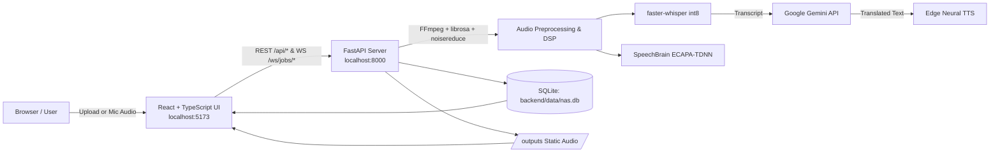
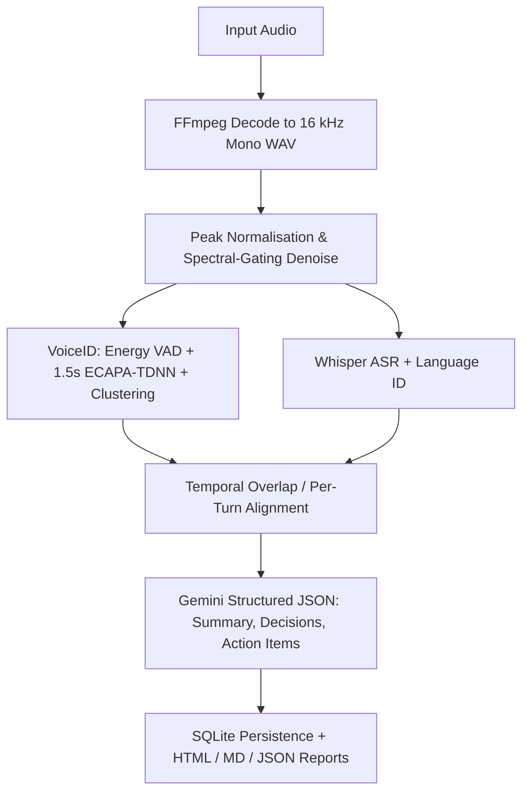
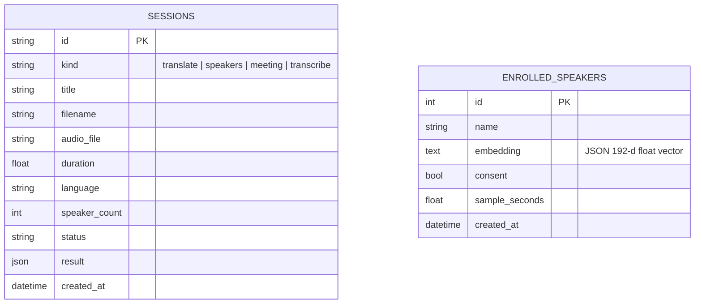

<div align="center">
  

  <h1>NAS</h1>
  <p><strong>Every voice. Every language. Every insight.</strong></p>

  <p>
    An AI-powered audio intelligence workspace bringing together multilingual speech recognition,
    contextual translation, speaker diarization &amp; verification, meeting analytics, and acoustic signal processing.
  </p>

  <p>
    
    
    
    
    
  </p>

  <p>
    <a href="#core-modules">Core Modules</a> •
    <a href="#system-architecture">Architecture</a> •
    <a href="#installation-and-setup">Setup</a> •
    <a href="#api-reference">API Reference</a> •
    <a href="#security-and-privacy">Security</a>
  </p>
</div>

---

## Table of Contents

- [Overview](#overview)
- [Core Modules](#core-modules)
  - [LinguaVoice — Multilingual Speech Intelligence](#linguavoice--multilingual-speech-intelligence)
  - [VoiceID — Speaker Intelligence](#voiceid--speaker-intelligence)
  - [MeetingLens — Meeting Intelligence](#meetinglens--meeting-intelligence)
  - [Audio Lab — Digital Signal Processing](#audio-lab--digital-signal-processing)
  - [Explainability Layer](#explainability-layer)
- [Technology Stack](#technology-stack)
- [System Architecture](#system-architecture)
- [Processing Pipelines](#processing-pipelines)
- [Installation and Setup](#installation-and-setup)
- [Environment Variables](#environment-variables)
- [API Reference](#api-reference)
- [Database Architecture](#database-architecture)
- [Repository Structure](#repository-structure)
- [Evaluation](#evaluation)
- [Troubleshooting](#troubleshooting)
- [Limitations and Future Improvements](#limitations-and-future-improvements)
- [Security and Privacy](#security-and-privacy)
- [Contributing](#contributing)
- [License](#license)
- [Acknowledgements](#acknowledgements)

---

## Overview

**NAS** is an integrated, local-first audio intelligence platform designed to run smoothly on standard CPU hardware (tested on 8 GB RAM laptops without a dedicated GPU). It unifies four speech-processing engines behind a single React + TypeScript interface and a FastAPI + SQLite backend:

1. **LinguaVoice:** Speech-to-text transcription, automatic language identification, Gemini-powered translation, and Edge neural text-to-speech.
2. **VoiceID:** Who-spoke-when speaker diarization using 192-D ECAPA-TDNN embeddings, cosine similarity matrices, agglomerative clustering, per-speaker language ID, consent-based enrollment, and two-recording verification.
3. **MeetingLens:** End-to-end meeting analysis combining diarization, multilingual transcription, temporal-overlap alignment, evidence-grounded Gemini summaries/decisions/action items, and HTML/Markdown/JSON report exports.
4. **Audio Lab:** Interactive acoustic signal-processing workbench displaying original and denoised waveforms, STFT spectrograms, Mel spectrograms, MFCC heatmaps, and energy-based Voice Activity Detection (VAD).

---

## Core Modules

### LinguaVoice — Multilingual Speech Intelligence

- **Input:** Audio file upload (`WAV`, `MP3`, `M4A`, `OGG`, `WEBM`, `FLAC`, `MP4` up to `100 MB`) or live browser microphone recording, plus a direct text translator.
- **Capabilities:**
  - Speech-to-text transcription via `faster-whisper` (`small`, `int8`, CPU).
  - Automatic language detection via Whisper's language-ID head (or manual source language selection).
  - Supported languages: English (`en`), Malayalam (`ml`), Hindi (`hi`), Tamil (`ta`), Kannada (`kn`), Telugu (`te`), French (`fr`), and Spanish (`es`).
  - Contextual transcript translation via Google Gemini with automatic multi-key and model fallback.
  - Neural speech synthesis (MP3) via `edge-tts` with selectable female/male voices.
  - Transcription-only mode (skips Gemini translation and TTS).

### VoiceID — Speaker Intelligence

- **Who Spoke When (Diarization):**
  - Energy-based VAD (`top_db=35`) → 1.5 s sliding windows (0.75 s hop) → 192-D `SpeechBrain` ECAPA-TDNN (`spkrec-ecapa-voxceleb`) embeddings → cosine-distance agglomerative clustering → smoothing and turn merging.
  - Automatic speaker count estimation via cosine silhouette score, or manual speaker count (`1`–`10`).
  - Optional `pyannote/speaker-diarization-3.1` backend when `HF_TOKEN` and `pyannote.audio` are configured.
  - Interactive speaker timeline, talk-share cards, cosine similarity matrix, and 2-D PCA embedding scatter plot.
- **Multilingual Language Identification:**
  - Aggregates each identified speaker's speech turns and runs Whisper's language-ID head to label each speaker's primary language without splitting speakers when languages change.
- **Speaker Enrollment & Verification:**
  - Consent-based enrollment (`consent=True` required) extracts and stores only the 192-D ECAPA-TDNN embedding in SQLite; the original enrollment audio is deleted immediately.
  - Two-recording verification computes cosine similarity against `MATCH_THRESHOLD = 0.55`. Similarity scores are acoustic resemblance indicators, **not** definitive proof of identity.

### MeetingLens — Meeting Intelligence

- **Asynchronous Pipeline:** Runs in the background via `/api/meeting/analyze` with real-time progress over WebSocket (`/ws/jobs/{id}`) and HTTP polling (`/api/jobs/{id}`).
- **Transcription Modes:**
  - *Multilingual:* Detects language and transcribes per speaker turn.
  - *Single-language:* Runs one Whisper pass and aligns text segments to speaker turns by temporal overlap (marking assignments `< 30%` overlap as `uncertain`).
- **Evidence-Grounded Intelligence:** Uses Gemini structured JSON output to extract executive summary, topics, sentiment, key points, decisions with verbatim supporting quotes, and action items (defaulting `owner` and `deadline` to `"Unknown"` unless explicitly stated).
- **Exports:** Downloadable reports in **HTML** (printable to PDF), **Markdown**, and **JSON**.

### Audio Lab — Digital Signal Processing

Computes and visualises verified DSP parameters from `backend/app/services/audio_processor.py`:

| Parameter | Configured Value |
|---|---|
| Sampling Rate | `16,000 Hz` (mono, peak-normalised) |
| Frame Length | `400 samples` (`25 ms`) |
| Hop Length | `160 samples` (`10 ms`) |
| Window Function | `Hamming` |
| FFT Size (`N_FFT`) | `512` |
| Mel Filterbank | `64` mel bands (log power) |
| MFCC Coefficients | `13` (mean-variance normalised) |
| VAD | Energy threshold (`top_db = 35.0`, `min_dur = 0.25 s`) |
| Noise Reduction | Spectral gating (`noisereduce`, `prop_decrease = 0.8`) |

### Explainability Layer

Every module includes a collapsible **"How this result was generated"** (`ProcessingExplanation`) panel backed by a static, predefined local registry (`frontend/src/data/explanations.ts`). It activates only after a successful result and never makes extra Gemini/LLM or backend API calls.

---

## Technology Stack

| Layer | Technologies | Role in NAS |
|---|---|---|
| **Frontend** | React 19, TypeScript, Vite 8, Tailwind CSS v4 | Component UI, routing, state management, responsive workspace |
| **Motion & Icons** | Framer Motion, GSAP, Lucide React | Page/tab transitions, staggered reveals, modal & toast animations |
| **Charts & Audio UI** | Recharts, HTML5 Canvas + Web Audio API | Area/pie/bar/PCA charts, interactive waveform, STFT/Mel/MFCC heatmaps |
| **Backend API** | Python 3.12/3.13, FastAPI, Uvicorn, Pydantic v2 | REST endpoints, WebSocket job progress, static `/outputs` serving |
| **ASR & Language ID** | `faster-whisper` (`small`, `int8`, CPU) | Multilingual speech transcription and per-speaker language detection |
| **Speaker Intelligence** | `SpeechBrain` (ECAPA-TDNN), `scikit-learn`, `PyTorch` | 192-D speaker embeddings, cosine similarity, clustering, PCA |
| **LLM & TTS** | `google-genai` (Gemini), `edge-tts` | Transcript translation, meeting intelligence JSON, neural MP3 synthesis |
| **Signal Processing** | `FFmpeg`, `librosa`, `noisereduce`, `soundfile`, `NumPy`, `SciPy` | Format decoding, 16 kHz resampling, spectral gating, STFT, Mel, MFCC, VAD |
| **Database** | SQLite, SQLAlchemy 2.x | Persistent session history (`sessions`) and speaker voiceprints (`enrolled_speakers`) |

---

## System Architecture



See [docs/architecture/system-architecture.md](docs/architecture/system-architecture.md) for detailed communication and model-caching notes.

---

## Processing Pipelines

### LinguaVoice & MeetingLens Flow



---

## Installation and Setup

### Prerequisites

1. **Python 3.12 or 3.13** ([python.org](https://www.python.org/))
2. **Node.js 20+** ([nodejs.org](https://nodejs.org/))
3. **FFmpeg** (required for MP3/M4A/WEBM/OGG decoding):
   - **Windows (PowerShell):**
     ```powershell
     winget install --id Gyan.FFmpeg -e
     ```
   - **macOS:** `brew install ffmpeg`
   - **Ubuntu/Debian:** `sudo apt install ffmpeg`

### Quick Start (Windows)

```powershell
git clone https://github.com/deonbinny7/nas-audio-intelligence.git
cd nas-audio-intelligence
```

Double-click `start_backend.bat` and `start_frontend.bat`, or run manually in two terminals:

#### 1. Backend Setup

```powershell
cd backend
python -m venv venv
.\venv\Scripts\Activate.ps1
pip install -r requirements.txt
copy .env.example .env
uvicorn app.main:app --port 8000
```

*(Linux/macOS: `source venv/bin/activate` and `cp .env.example .env`.)*

#### 2. Frontend Setup

```powershell
cd frontend
npm install
npm run dev
```

Open **[http://localhost:5173](http://localhost:5173)** → **Settings** → paste your Gemini API key(s) → **Save settings**.
FastAPI interactive API documentation is available at **[http://localhost:8000/docs](http://localhost:8000/docs)**.

> **First-Run Model Downloads:** On first use, `faster-whisper` (`small`, ~480 MB) and `SpeechBrain` ECAPA-TDNN (~80 MB) download automatically into `backend/pretrained_models/`.

---

## Environment Variables

Template provided in [`backend/.env.example`](backend/.env.example):

| Variable | Required | Default | Consumed By | Purpose |
|---|---|---|---|---|
| `GEMINI_API_KEY` | For translation & MeetingLens | `""` | `gemini_client.py` | Gemini API key (comma-separate multiple keys for automatic quota fallback) |
| `GEMINI_MODEL` | No | `gemini-3.8-flash` | `gemini_client.py` | Primary Gemini model (falls back to `gemini-3.5-flash`, `gemini-2.5-flash-lite`) |
| `HF_TOKEN` | Optional | `""` | `speaker_diarization.py` | Hugging Face token, only required if using `pyannote/speaker-diarization-3.1` |
| `WHISPER_MODEL` | No | `small` | `speech_recognition.py` | Whisper model size (`tiny`, `base`, `small`, `medium`) |
| `WHISPER_COMPUTE_TYPE` | No | `int8` | `speech_recognition.py` | CTranslate2 quantization type (`int8` for CPU) |
| `DIARIZATION_BACKEND` | No | `auto` | `speaker_diarization.py` | `auto`, `speechbrain`, or `pyannote` |
| `NOISE_REDUCTION` | No | `true` | `audio_processor.py` | Enable spectral-gating noise reduction before ASR |

---

## API Reference

### LinguaVoice
| Method | Endpoint | Purpose |
|---|---|---|
| `GET` | `/api/languages` | List supported languages and Edge TTS voice profiles |
| `POST` | `/api/transcribe` | Upload audio → Whisper ASR + language candidates |
| `POST` | `/api/translate` | Upload audio → Whisper ASR → Gemini translation → Edge TTS MP3 |
| `POST` | `/api/translate/text` | Translate typed text via Gemini |
| `POST` | `/api/tts` | Synthesise text to MP3 via Edge TTS |

### VoiceID
| Method | Endpoint | Purpose |
|---|---|---|
| `POST` | `/api/speakers` | Diarize speakers (`num_speakers`, `detect_language` per speaker) |
| `POST` | `/api/speakers/enroll` | Extract & store 192-D voice embedding (`consent=true` required) |
| `GET` | `/api/speakers/enrolled` | List enrolled speakers and `match_threshold` |
| `DELETE` | `/api/speakers/enrolled/{sid}` | Delete an enrolled speaker embedding |
| `POST` | `/api/speakers/verify` | Compare two audio recordings via ECAPA-TDNN cosine similarity |

### MeetingLens
| Method | Endpoint | Purpose |
|---|---|---|
| `POST` | `/api/meeting/analyze` | Start asynchronous meeting analysis job (`job_id`) |
| `GET` | `/api/jobs/{jid}` | Poll background job stage and progress |
| `WS` | `/ws/jobs/{jid}` | Stream real-time job progress over WebSocket |
| `GET` | `/api/meeting/{mid}` | Retrieve full meeting transcript, speakers, summary, and audio analysis |
| `POST` | `/api/meeting/{mid}/translate` | Translate stored meeting transcript lines |
| `POST` | `/api/meeting/{mid}/summarize` | Regenerate meeting intelligence summary |
| `GET` | `/api/meeting/{mid}/report` | Export report (`?format=html\|md\|json`) |

### Audio Lab, History & System
| Method | Endpoint | Purpose |
|---|---|---|
| `POST` | `/api/audio/analyze` | Compute waveforms, STFT, Mel, MFCC, and VAD |
| `GET` | `/api/history` | List persisted sessions (optional `?kind=` filter) |
| `GET` | `/api/history/{sid}` | Retrieve full session result |
| `DELETE` | `/api/history/{sid}` | Delete a session record |
| `GET` | `/api/stats` | Dashboard metrics, daily activity, and language counts |
| `GET` | `/api/health` | Backend readiness (FFmpeg, Whisper, VoiceID, Gemini) |
| `GET` / `POST` | `/api/settings` | Read (masked) or update `backend/.env` settings |
| `POST` | `/api/system/unload` | Unload Whisper and ECAPA-TDNN models from RAM |

---

## Database Architecture

NAS uses **SQLite** (`backend/data/nas.db`) via SQLAlchemy 2.x (`backend/app/models/database.py`):



---

## Repository Structure

```text
NAS/
├── README.md
├── CONTRIBUTING.md
├── SECURITY.md
├── CODE_OF_CONDUCT.md
├── CHANGELOG.md
├── .gitignore
├── .editorconfig
├── .gitattributes
├── start_backend.bat
├── start_frontend.bat
├── docs/
│   ├── architecture/system-architecture.md
│   └── development/troubleshooting.md
├── backend/
│   ├── .env.example
│   ├── requirements.txt
│   ├── requirements-pyannote.txt
│   └── app/
│       ├── main.py
│       ├── config.py
│       ├── api/            # history.py, meeting.py, speaker.py, translator.py
│       ├── models/         # database.py, schemas.py
│       ├── services/       # pipeline.py, speech_recognition.py, speaker_diarization.py,
│       │                   # audio_processor.py, gemini_client.py, meeting_analyzer.py,
│       │                   # translation.py, text_to_speech.py, alignment.py, jobs.py
│       └── utils/          # audio_utils.py, file_handler.py, metrics.py
├── frontend/
│   ├── index.html
│   ├── package.json
│   ├── package-lock.json
│   ├── vite.config.ts
│   ├── public/             # nas-logo.png, nas-icon.png
│   └── src/
│       ├── App.tsx
│       ├── index.css
│       ├── components/     # Layout, ui, Toast, ProcessingExplanation, AudioInput,
│       │                   # Waveform, SpeakerTimeline, SpeakerViews, Heatmap, AudioAnalysisPanel
│       ├── data/           # explanations.ts (static explainability registry)
│       ├── hooks/          # useAsync, useJob, useRecorder, useGsapEntrance
│       ├── pages/          # Dashboard, LinguaVoice, VoiceID, MeetingLens, MeetingDetail,
│       │                   # AudioLab, History, Settings
│       ├── services/       # api.ts
│       └── types/          # index.ts
├── samples/                # Demo multilingual audio clips
└── scripts/
    └── evaluate.py         # WER & DER evaluation CLI
```

---

## Evaluation

Compute Word Error Rate (WER) and Diarization Error Rate (DER) using [`scripts/evaluate.py`](scripts/evaluate.py):

```powershell
cd backend
.\venv\Scripts\Activate.ps1
python ..\scripts\evaluate.py wer ..\samples\s1_en.mp3 "We need to complete the project by Friday. The frontend is almost done."
python ..\scripts\evaluate.py der my_meeting.wav my_meeting_reference.csv --speakers 3
```

---

## Troubleshooting

See [docs/development/troubleshooting.md](docs/development/troubleshooting.md) for solutions to FFmpeg detection, Gemini quota fallback, first-run model downloads, Windows Vite/Rolldown native bindings, and RAM management.

---

## Limitations and Future Improvements

### Current Limitations
- **CPU Inference Latency:** Running Whisper `small` and ECAPA-TDNN on CPU takes roughly 1–2× the audio duration; first-time runs also download model weights.
- **No Automated Test Suite:** The repository currently relies on TypeScript compilation (`tsc -b`), Vite bundling, and `scripts/evaluate.py` rather than a full pytest/Vitest suite.
- **Speaker Verification:** Cosine similarity is probabilistic and sensitive to background noise and microphone differences.

### Future Improvements
- Add automated unit/integration tests for FastAPI routes and React components.
- Optional GPU acceleration (`CUDA`) configuration toggle in Settings.
- Real-time streaming transcription over WebSockets.

---

## Security and Privacy

- Real credentials in `backend/.env` are excluded from Git via `.gitignore` and masked in `/api/settings` responses.
- Audio decoding, Whisper ASR, ECAPA-TDNN diarization, and DSP run locally. Only recognised text transcripts are sent to Google Gemini (and translated text to Edge TTS when speech synthesis is enabled).
- Voice enrollment requires explicit consent (`consent=true`) and deletes the raw audio file immediately after saving the 192-D embedding.
- See [SECURITY.md](SECURITY.md) for vulnerability reporting.

---

## Contributing

Contributions are welcome! Please read [CONTRIBUTING.md](CONTRIBUTING.md) and [CODE_OF_CONDUCT.md](CODE_OF_CONDUCT.md) before opening a pull request.

---

## License

*A software license has not yet been selected for this repository. Please contact the repository owner or open an issue regarding licensing.*

---

## Acknowledgements

- [faster-whisper](https://github.com/SYSTRAN/faster-whisper) (CTranslate2 Whisper inference)
- [SpeechBrain](https://speechbrain.github.io/) (`spkrec-ecapa-voxceleb` ECAPA-TDNN)
- [Google Gemini API](https://ai.google.dev/) (`google-genai`)
- [edge-tts](https://github.com/rany2/edge-tts)
- [librosa](https://librosa.org/) & [noisereduce](https://github.com/timsainb/noisereduce)
- [FastAPI](https://fastapi.tiangolo.com/), [React](https://react.dev/), [Tailwind CSS](https://tailwindcss.com/), [Recharts](https://recharts.org/), [GSAP](https://gsap.com/), and [Framer Motion](https://www.framer.com/motion/)
